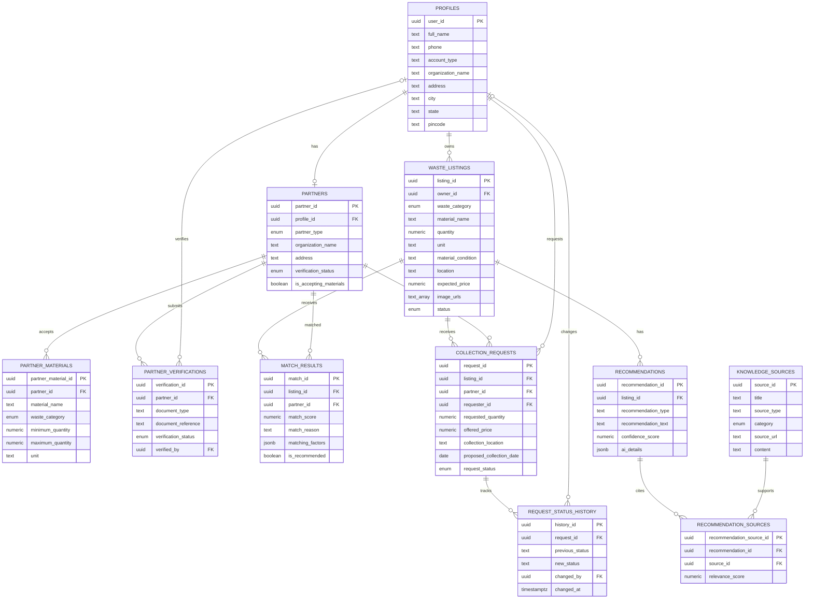

# Waste2Wealth — Entity Relationship Diagram
**Status:** Proposed logical model aligned with the implemented Supabase table set. Confirm against the live schema before final approval.

## Entity purposes
| Table | Purpose |
|---|---|
| profiles | User profile and role; user_id corresponds to Supabase Auth user |
| waste_listings | Agricultural/electronic waste listings |
| partners | Buyer, recycler, refurbisher, collection agency or processor |
| partner_materials | Materials and quantity ranges accepted by partners |
| partner_verifications | Verification submissions and review outcome |
| match_results | Candidate partner matches, scores and explanations |
| collection_requests | Request from generator to partner |
| request_status_history | Audit trail of request status changes |
| recommendations | AI-assisted reuse/recycling suggestions |
| knowledge_sources | Reference information supporting recommendations |
| recommendation_sources | Junction table linking recommendations and sources |

## Relationship notes
- One profile can own many listings.
- A profile can have at most one partner row (`partners.profile_id` is unique).
- A partner can have many accepted materials and verification records.
- Match results link one listing to one partner; current schema has a unique `(listing_id, partner_id)` rule.
- A request links one listing, one partner and one requester profile; it can have many history records.
- A listing can have many recommendations.
- Recommendations and knowledge sources are many-to-many through `recommendation_sources`.
- `profiles.user_id` references `auth.users.id`; listing owners, partner profiles and request actors reference `profiles.user_id`.
- No dedicated vehicle/driver/transport-booking entity exists in the current MVP schema.
