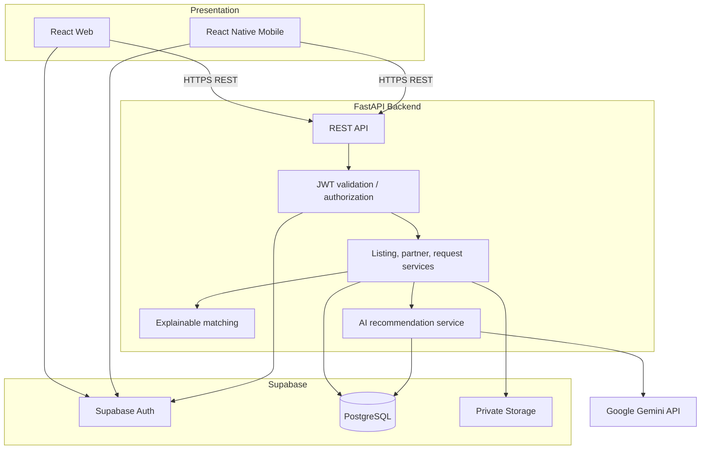

# Waste2Wealth — System Architecture
**Status:** Design draft | **Style:** Cross-platform clients, shared REST backend and Supabase managed services.

## 1. Objectives
Shared services for web/mobile; centralized business logic and authorization; Supabase for identity, database and files; Gemini accessed only by backend; explainable matching separated from generative AI.

## 2. Technology stack
| Layer | Technology | Responsibility |
|---|---|---|
| Web | React | Browser UI |
| Mobile | React Native | Mobile UI |
| Backend | Python, FastAPI | REST APIs, validation, business logic |
| Identity | Supabase Auth | Signup, login, JWT |
| Database | Supabase PostgreSQL | Application records |
| Storage | Supabase Storage | Listing images and verification files |
| AI | Google Gemini API | Advisory recommendations/explanations |

## 3. High-level architecture

## 4. Component responsibilities
- React: signup/login UI, profile, listings, partner directory, requests and recommendations.
- React Native: mobile workflows using the same API.
- FastAPI: JWT validation, role/ownership checks, Pydantic validation, business services, Gemini calls, error handling.
- Supabase Auth: identity and tokens.
- PostgreSQL: profiles, listings, partners, matches, requests and recommendations.
- Storage: private images and verification documents.
- Gemini: advisory AI support; cannot verify partners or authorize transactions.

## 5. Main flows
**Authentication:** client signs in with Supabase; receives JWT; sends bearer token to FastAPI; backend validates token and checks authorization.

**Listing:** client submits listing; backend validates fields and ownership; database stores listing; protected storage flow handles images.

**Matching:** backend retrieves listing and candidate partners; rule-based matching checks material, quantity, location and partner eligibility; stores score and reason.

**Recommendation:** backend retrieves listing and relevant knowledge; calls Gemini with minimum required context; validates output; stores recommendation and source links; client displays advisory result.

**Collection:** generator creates request; backend validates; partner responds; backend checks allowed status transition and records history.

## 6. Matching and AI separation
Matching score and eligibility are calculated using explicit backend rules. Gemini may assist with reuse suggestions or explanations. Gemini output must not override verification, ownership or authorization rules.

## 7. Deployment principles
Use server-side secrets; separate development/production configuration; HTTPS; restrictive CORS; controlled migrations; no secrets in Git or client bundles; log without passwords, tokens or document contents.

## 8. MVP limitation
No dedicated transport-provider, vehicle, driver, booking or live-tracking table exists in the current schema. MVP coordination uses collection location, proposed date, partner response and request statuses.
