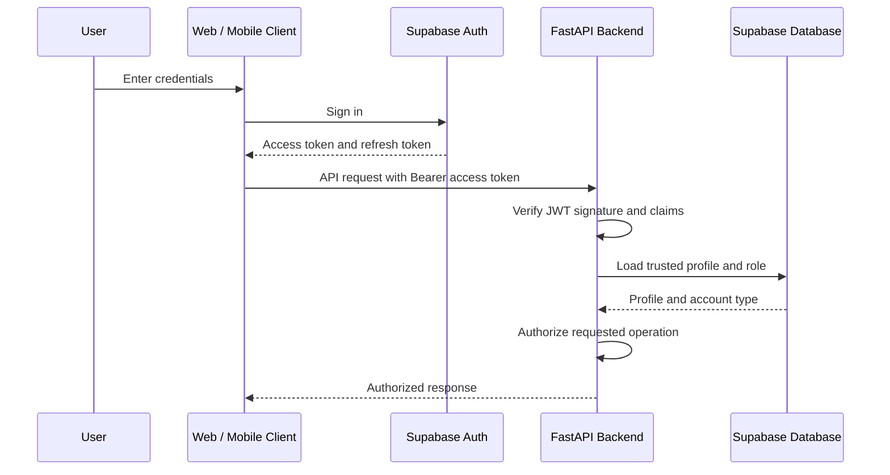

# Waste2Wealth — Authentication and Security

> **Document status:** Security design and implementation requirements  
> **Identity provider:** Supabase Auth  
> **Authorization:** Application roles, backend checks, and PostgreSQL RLS  
> **Sensitive credentials:** Server-side only

## 1. Introduction

Waste2Wealth handles user profiles, contact details, waste listings, partner information, verification documents, collection requests, and AI-assisted recommendations. Security must protect this information and ensure that users can perform only the actions permitted to them.

This document describes the intended authentication, authorization, data-protection, storage, API, and operational security controls.

## 2. Security Objectives

- Authenticate users securely.
- Ensure users can access only data they are permitted to view.
- Prevent users from changing their own privileged roles.
- Restrict partner-only and administrator operations.
- Protect verification documents and uploaded listing images.
- Prevent service credentials and AI API keys from reaching clients.
- Maintain trustworthy request status history.
- Validate all client input and external AI output.
- Record security-relevant events without exposing secrets.

## 3. Authentication Architecture

Supabase Auth manages user registration, login, password recovery, and access-token issuance.

Typical authentication flow:



### 3.1 Token Handling

- The client obtains tokens through Supabase Auth.
- Protected API requests include the access token in the `Authorization: Bearer` header.
- FastAPI verifies the JWT signature, issuer, audience, expiry, and other required claims according to the actual Supabase project configuration.
- Do not assume a signing algorithm or hard-code an obsolete JWT secret. Inspect the project's current JWT signing configuration and use the appropriate verification method.
- Refresh tokens must be handled through the supported Supabase client flow and stored using platform-appropriate secure storage.
- Never log access tokens, refresh tokens, passwords, or API secrets.

## 4. User Roles and Authorization

The `profiles.account_type` field supports these values:

| Role | Main responsibilities |
|---|---|
| `generator` | Create and manage own waste listings; review requests for own listings. |
| `partner` | Manage partner profile and accepted materials; discover eligible listings; submit requests when verified. |
| `both` | Use generator and partner workflows, subject to partner-record and verification requirements. |
| `admin` | Perform authorized administrative tasks, including partner verification and platform monitoring. |

### 4.1 Role Assignment

- A new user should receive the least-privileged default role, normally `generator`.
- Users must not be able to promote themselves to `partner`, `both`, or `admin` by editing their own profile.
- Partner onboarding must use a trusted, narrowly scoped backend/database operation.
- Administrator privileges must be granted through a controlled administrative process, not public sign-up.
- The backend must load roles from trusted database records after verifying the user's JWT.

### 4.2 Authorization Principles

Use both application-level authorization and database-level RLS:

1. Authenticate the caller.
2. Identify the caller from the verified token.
3. Load trusted profile and partner status.
4. Check resource ownership and role.
5. Execute the operation using the least-privileged database access method.
6. Let RLS and database constraints provide an additional enforcement layer.

A frontend route guard or hidden button is only a user-experience feature; it is not a security boundary.

## 5. Row-Level Security (RLS)

RLS is enabled on all 11 application tables in the current database inspection.

RLS policies should enforce the following principles:

| Table | Security objective |
|---|---|
| `profiles` | Users can read/update permitted fields of their own profile; admins have controlled access. |
| `waste_listings` | Owners manage their own listings; other users see only listings permitted by visibility rules. |
| `partners` | Partner owners manage permitted fields; public/partner viewers see only approved public information. |
| `partner_materials` | Partner owners manage their accepted-material records; other access is limited to discovery needs. |
| `partner_verifications` | Partner owners can manage/view their submissions as permitted; administrators review them. |
| `match_results` | System-generated records are not directly writable by ordinary clients. |
| `collection_requests` | Only authorized participants and administrators can view or act on a request. |
| `request_status_history` | History is readable by authorized participants; writes are controlled and auditable. |
| `recommendations` | Recommendations are visible only to permitted users; generation/storage is controlled. |
| `knowledge_sources` | Reference data is managed by trusted administrators or backend processes. |
| `recommendation_sources` | Links are controlled with recommendation and source access rules. |

RLS must be tested for both allowed and denied access. Enabling RLS alone does not prove the policies are correct.

## 6. Sensitive Database Operations

Some operations should not be performed as arbitrary direct client writes:

- Creating or updating system-generated matching results.
- Creating AI recommendation records.
- Inserting request status history.
- Changing collection request status.
- Registering a partner or changing account role.
- Approving/rejecting partner verification.

These operations should be handled through narrowly scoped backend endpoints or carefully designed PostgreSQL functions with explicit authorization checks.

### 6.1 Service-Role Key

The Supabase service-role key bypasses RLS and must be treated as a highly privileged secret.

- Store it only in the backend's protected environment.
- Never include it in React, React Native, browser bundles, mobile application configuration, or Git history.
- Use user-scoped JWT access for ordinary operations wherever possible.
- If service-role access is required, isolate it to specific operations and independently verify the caller's identity, role, ownership, and input.
- Do not use service-role access as a shortcut around missing authorization policies.

## 7. Collection Request Security

Collection requests affect real users and must have strong authorization and state validation.

Required controls:

- Derive the requester identity from the verified JWT; do not trust a client-supplied requester profile ID.
- Confirm that the authenticated user is authorized to act for the specified partner.
- Confirm that the partner meets verification and accepting-materials requirements.
- Confirm that the listing is visible and available.
- Validate requested quantity and relevant listing limits.
- Enforce allowed state transitions.
- Update the request and insert its history record atomically.
- Lock or otherwise protect relevant records during concurrent state changes.
- Restrict cancellation and completion rules to explicitly authorized actors.

The request workflow should reject invalid transitions rather than silently changing status.

## 8. File and Storage Security

Two private Supabase Storage buckets are used:

- `waste-listing-images`
- `partner-verification-documents`

### 8.1 Listing Images

- Permit uploads only for authorized listing owners.
- Validate file size and MIME type.
- Generate unpredictable object paths.
- Do not trust filenames or content types supplied by the client.
- Keep the bucket private unless a deliberate public-image policy is reviewed.
- Use authorized access or short-lived signed URLs to display images.

### 8.2 Verification Documents

Verification documents may contain sensitive business or personal information.

- Keep the bucket private.
- Restrict access to the submitting partner and authorized administrators.
- Do not expose permanent public URLs.
- Validate file type and size.
- Avoid logging document contents or signed URLs.
- Remove or expire documents according to a documented retention policy where applicable.

## 9. Gemini API Security and AI Safety

The Gemini API key must be stored only in the backend environment.

Security controls:

- Never call Gemini directly from the browser or mobile application using a secret key.
- Send only the minimum information required for a recommendation.
- Validate and constrain input length.
- Treat model output as untrusted text/data.
- Validate structured output against a Pydantic schema before saving or displaying it.
- Do not execute generated code, SQL, URLs, or commands.
- Do not allow model output to change roles, approve partners, authorize requests, or alter database state.
- Handle provider errors and rate limits gracefully.
- Provide a deterministic fallback or explain that recommendations are temporarily unavailable.

AI-generated reuse advice is informational and should not replace expert, regulatory, or safety guidance.

## 10. Input Validation and Application Security

- Use Pydantic request models for API validation.
- Enforce quantity, unit, category, date, and price constraints.
- Apply maximum lengths to user-provided text.
- Use parameterized database queries or safe Supabase client methods.
- Prevent insecure direct object references by checking ownership on every resource operation.
- Apply rate limits to sensitive and expensive endpoints.
- Restrict production CORS to approved origins.
- Use HTTPS in deployed environments.
- Keep dependencies updated and scan for known vulnerabilities.
- Return generic client-facing errors; keep detailed diagnostics in protected logs.
- Avoid storing unnecessary personal information.

## 11. Secrets and Environment Management

Example backend environment variables:

```env
SUPABASE_URL=
SUPABASE_ANON_KEY=
SUPABASE_SERVICE_ROLE_KEY=
GEMINI_API_KEY=
```

Example frontend environment variables may contain only values intended for public client use, such as the Supabase project URL and publishable/anon key, plus the API base URL.

Rules:

- Add `.env`, `.env.*` (except safe example templates), secrets, private keys, and local credential files to `.gitignore`.
- Commit `.env.example` with placeholder values only.
- Rotate any key accidentally committed or exposed.
- Use separate credentials for development and production.
- Do not paste secrets into issue trackers, screenshots, README files, or public chat messages.

## 12. Logging, Monitoring, and Auditing

Log:

- Authentication failures and suspicious access attempts.
- Administrative verification decisions.
- Collection request state changes.
- Important backend errors and external-service failures.

Do not log:

- Passwords or access/refresh tokens.
- Service-role keys or Gemini API keys.
- Full verification-document contents.
- Sensitive personal information unless strictly required.

Use request IDs and timestamps to correlate events. Restrict access to logs.

## 13. Security Testing Checklist

- [ ] Unauthenticated users cannot access protected endpoints.
- [ ] Expired or invalid JWTs are rejected.
- [ ] Users cannot change their own account role.
- [ ] A generator cannot edit another user's listing.
- [ ] An unverified partner cannot perform verified-partner actions.
- [ ] A user cannot submit a request while impersonating another partner.
- [ ] A request participant cannot access unrelated requests.
- [ ] Invalid request-state transitions are rejected.
- [ ] Request status and history are updated atomically.
- [ ] Private verification documents are inaccessible to unauthorized users.
- [ ] Listing image access follows the intended visibility policy.
- [ ] Service-role and Gemini keys are absent from client bundles and Git history.
- [ ] AI provider failures do not break core listing and request functionality.
- [ ] Admin endpoints reject non-admin users.

## 14. Migration and Change-Control Status

Security-related database changes must be reviewed before execution.

In particular, any proposed migration that changes listing visibility, request validation, status transitions, partner registration, grants, or security-definer functions must be:

1. Compared with the live schema and existing function definitions.
2. Reviewed for caller identity and authorization checks.
3. Checked for concurrency and transaction behaviour.
4. Checked for exact grants and function ownership/security settings.
5. Tested in a safe environment where possible.
6. Approved explicitly before execution.
7. Followed by positive and negative security tests.

Do not describe a proposed migration or function as deployed until it has actually been approved, applied, and verified.

## 15. Conclusion

Waste2Wealth uses layered security: Supabase Auth for identity, trusted profile data for roles, FastAPI for application authorization, PostgreSQL RLS for database-level enforcement, private storage for uploaded files, and server-side secret management for external integrations. These controls must be tested together to protect users and platform data.
