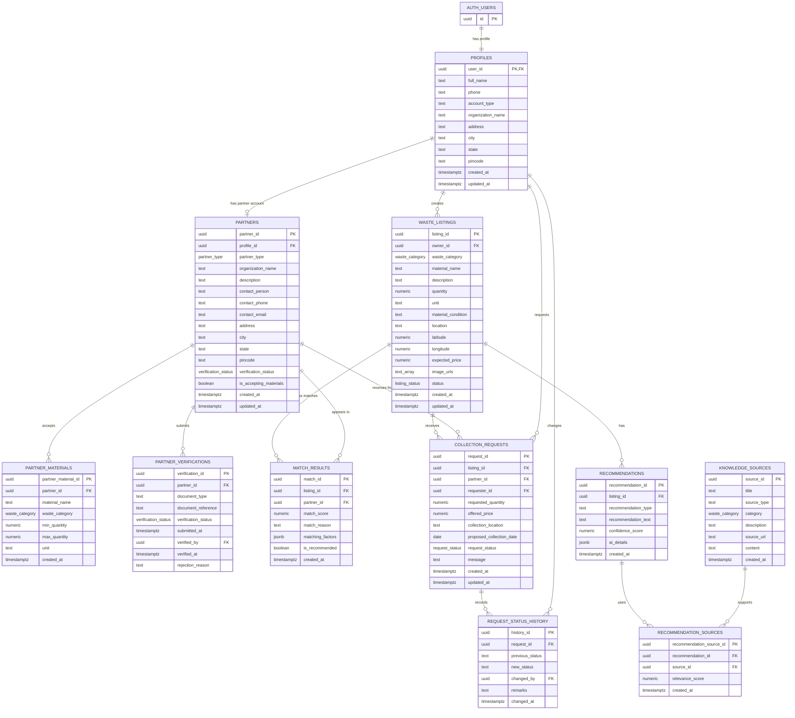

# Waste2Wealth — Entity Relationship Diagram

> **Document status:** Design documentation  
> **Database:** Supabase PostgreSQL  
> **Scope:** Current 11-table database design  
> **Last reviewed:** 20 November 2026

## 1. Overview

The Waste2Wealth database is designed to support user profiles, agricultural and electronic waste listings, recycling partners, partner verification, matching, collection requests, request history, and AI-assisted recommendations.

The database contains 11 principal tables. Supabase Authentication stores login identities in `auth.users`; the application profile is maintained separately in `public.profiles`.

## 2. Entity Relationship Diagram

The following Mermaid ER diagram describes the principal relationships. Supabase's `auth.users` table is shown as an external authentication entity.

## 3. Entity Descriptions

| Entity | Purpose |
|---|---|
| `profiles` | Stores application profile details linked to Supabase Auth users. |
| `waste_listings` | Stores agricultural and electronic waste offered by generators. |
| `partners` | Stores buyer, recycler, refurbisher, collection agency, and processor profiles. |
| `partner_materials` | Records materials and quantity ranges a partner can accept. |
| `partner_verifications` | Stores partner verification submissions and review outcomes. |
| `match_results` | Stores system-generated compatibility results between listings and partners. |
| `collection_requests` | Stores purchase or collection requests associated with a listing and partner. |
| `request_status_history` | Maintains an audit trail of request status changes. |
| `recommendations` | Stores AI-assisted or system-generated waste utilization recommendations. |
| `knowledge_sources` | Stores reference material used to support recommendations. |
| `recommendation_sources` | Links recommendations to supporting knowledge sources. |

## 4. Important Relationships and Business Rules

1. A Supabase Auth user has one application profile. `profiles.user_id` references `auth.users.id`.
2. A profile may own multiple waste listings.
3. A profile may have one partner record. `partners.profile_id` is unique.
4. A partner may accept multiple materials and submit multiple verification records.
5. A waste listing may have multiple matching partners.
6. A listing may receive multiple collection requests.
7. Each collection request belongs to one listing, one partner, and one requesting profile.
8. A collection request may have multiple status-history records.
9. A listing may have multiple recommendations.
10. Recommendations and knowledge sources are connected through `recommendation_sources`, allowing many-to-many relationships.

## 5. Enumerated Types

The database uses the following enum types:

| Enum | Values |
|---|---|
| `waste_category` | `agricultural`, `electronic` |
| `listing_status` | `active`, `reserved`, `completed`, `cancelled` |
| `partner_type` | `buyer`, `recycler`, `refurbisher`, `collection_agency`, `processor` |
| `verification_status` | `pending`, `verified`, `rejected` |
| `request_status` | `pending`, `accepted`, `rejected`, `scheduled`, `collected`, `completed`, `cancelled` |

The `profiles.account_type` field is a constrained text field, not one of the five enum types listed above. Its allowed values are `generator`, `partner`, `both`, and `admin`.

## 6. Design Notes and Verification

- Waste images are represented by paths in `waste_listings.image_urls`; there is no separate listing-images table in the current design.
- Partner verification documents are stored in private Supabase Storage. `document_reference` should contain a storage object reference/path, not a public secret or unrestricted URL.
- `match_results`, `recommendations`, and `request_status_history` are system-controlled records. Their write operations must be performed through appropriately secured backend logic or database functions.
- The ER diagram describes the known database structure. Confirm exact column types, delete actions, and constraint names against the live Supabase schema before treating this document as a migration specification.
- If a future migration adds columns or functions, update this diagram only after that migration has been reviewed and applied.

## 7. Conclusion

The ER model separates user identity, waste listings, partner capabilities, matching, collection workflow, and recommendation knowledge. This structure supports the core Waste2Wealth workflow while keeping the database modular and understandable.
