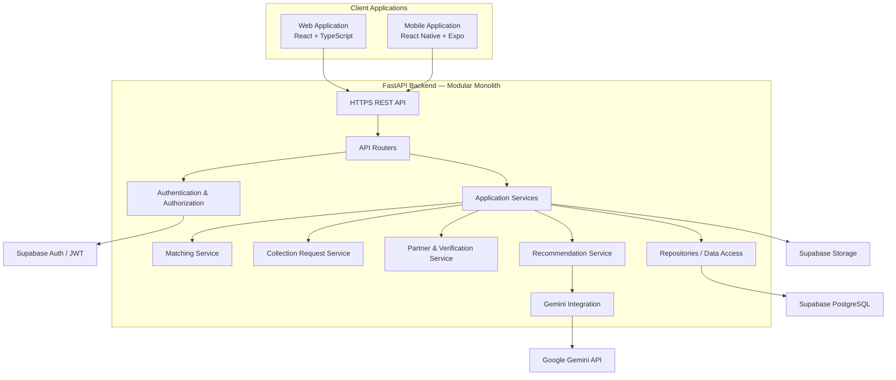

# Waste2Wealth — System Architecture

> **Document status:** Target architecture and implementation guide  
> **Architecture style:** Modular monolith with layered backend  
> **Platforms:** Web and mobile  
> **Backend:** FastAPI  
> **Data platform:** Supabase

## 1. Introduction

Waste2Wealth is a cross-platform waste-recovery application connecting waste generators with buyers, recyclers, refurbishers, processors, and collection agencies.

The system provides waste listing, partner discovery, matching, AI-assisted recommendations, partner verification, collection request coordination, and request tracking.

The architecture is designed to be understandable and maintainable by a two-member student team. It uses a modular monolith rather than a microservices architecture to reduce deployment and operational complexity.

## 2. Architectural Goals

- Provide a consistent experience across web and mobile.
- Keep business rules in a centralized backend.
- Separate API routing, validation, business logic, and data access.
- Protect credentials and privileged operations.
- Support agricultural and electronic waste workflows.
- Keep matching explainable and deterministic.
- Use AI as an assistance layer, not as the authority for critical business decisions.
- Remain feasible to build, test, and deploy within the project constraints.

## 3. High-Level Architecture



## 4. Technology Stack

| Layer | Technology | Responsibility |
|---|---|---|
| Web client | React, TypeScript | Browser-based user interface |
| Mobile client | React Native, Expo, TypeScript | Android/iOS-oriented user interface |
| API backend | Python, FastAPI | REST endpoints and business logic |
| Validation | Pydantic v2 | Request/response validation |
| Database | Supabase PostgreSQL | Relational application data |
| Authentication | Supabase Auth | User identity and JWT issuance |
| File storage | Supabase Storage | Listing images and verification documents |
| AI provider | Google Gemini API | AI-assisted recommendation explanations |
| API documentation | OpenAPI / Swagger UI | Interactive API reference |
| Version control | Git and GitHub | Source management and collaboration |

## 5. Client Applications

### 5.1 Web Application

The web application is the primary broad-access interface. It supports:

- Registration, login, and profile management.
- Waste listing creation and management.
- Partner discovery and partner profile views.
- Matching results and recommendations.
- Collection request workflows.
- Administrator operations and verification review.

The web client must call the FastAPI backend for protected business operations. It must not contain service-role credentials or the Gemini API key.

### 5.2 Mobile Application

The mobile application provides the essential generator and partner workflows in a mobile-friendly interface:

- Authentication and profile access.
- Creating and viewing waste listings.
- Uploading listing images.
- Discovering matching partners.
- Sending or responding to collection requests.
- Viewing request status and recommendations.

Administrative functionality may remain web-only in the initial release to keep the mobile scope feasible.

## 6. Backend Architecture

The backend follows a layered modular-monolith structure.

```text
backend/
└── app/
    ├── main.py
    ├── api/
    │   ├── routes/
    │   └── dependencies/
    ├── core/
    │   ├── config.py
    │   ├── security.py
    │   └── exceptions.py
    ├── schemas/
    ├── services/
    ├── repositories/
    └── integrations/
        ├── supabase/
        └── gemini/
```

This is a target organization; use the actual implementation's folder names if they differ.

### 6.1 API Layer

- Defines HTTP routes and endpoint contracts.
- Reads authenticated user context.
- Validates request payloads.
- Calls the appropriate service.
- Returns consistent response models.

### 6.2 Core / Security Layer

- Loads environment configuration.
- Verifies Supabase access tokens.
- Resolves the user's profile and account role.
- Enforces authorization dependencies.
- Provides common exception handling and logging.

### 6.3 Service Layer

Contains application use cases and business rules, including:

- Listing creation, update, and visibility.
- Partner onboarding and verification.
- Matching and ranking.
- Collection request creation and state transitions.
- Recommendation generation and retrieval.

### 6.4 Repository / Data Access Layer

Encapsulates database operations and reduces direct database logic inside API routes. It should use the user's JWT for normal user-scoped access wherever possible. Privileged service-role access must be isolated to narrowly defined operations.

### 6.5 External Integrations

- Supabase integration handles database, authentication-related verification, and storage operations.
- Gemini integration sends only the minimum necessary information to the model and validates its response before returning it to the client.

## 7. Core Application Workflows

### 7.1 Waste Listing Workflow

1. A generator authenticates.
2. The client submits listing details and optional images.
3. The backend validates material category, quantity, unit, and location.
4. Images are uploaded to the private listing-image bucket using an authorized flow.
5. The listing is stored in PostgreSQL.
6. Matching is initiated or refreshed for eligible partners.

### 7.2 Partner Onboarding Workflow

1. A user requests partner onboarding.
2. The backend validates the user's identity and eligibility.
3. A partner record is created with pending verification status.
4. The partner submits required documents to private storage.
5. An administrator reviews the submission.
6. The partner becomes verified or receives a rejection reason.
7. Only verified partners are eligible for restricted partner operations and matching, according to the business rules.

### 7.3 Matching Workflow

The initial matching engine should be deterministic and explainable.

Suggested factors:

- Material/category compatibility.
- Partner's accepted-material list.
- Minimum and maximum quantity compatibility.
- Partner accepting-materials status.
- Geographic compatibility using available location fields.

A weighted score can rank eligible partners. The exact weights must be documented in the implementation and tested. Do not claim precise distance matching unless reliable coordinates are available for both sides.

### 7.4 Collection Request Workflow

1. A verified partner selects an eligible listing.
2. The partner submits requested quantity, offer, proposed date, location, and message.
3. The backend/database verifies that the requester is authorized for that partner.
4. The generator reviews and accepts or rejects the request.
5. Accepted requests can be scheduled.
6. The parties coordinate collection directly.
7. The request progresses through collected and completed states as applicable.
8. Each valid transition is recorded in request history.

Waste2Wealth coordinates the workflow; it does not operate a transportation fleet.

### 7.5 AI-Assisted Recommendation Workflow

1. The backend gathers relevant listing attributes.
2. It selects suitable reference knowledge where available.
3. It calls Gemini through a server-side integration.
4. The response is parsed and validated.
5. The recommendation is stored with supporting details and sources where applicable.
6. The client displays the result with appropriate limitations.

AI output must be treated as advisory. It must not independently verify partners, approve transactions, determine legal compliance, or perform unsafe material-processing instructions.

## 8. Matching and AI Design Principles

**Deterministic matching first:** Eligibility and ranking should be based on explicit rules and stored partner capabilities. This makes results testable and reproducible.

**AI for explanation and suggestions:** Gemini may help generate understandable agricultural reuse suggestions. It should not decide authorization, partner verification, request status, or access permissions.

**Explainability:** Store the matching factors and a human-readable reason so users can understand why a partner was suggested.

**Fallback:** If Gemini is unavailable, the platform should still allow core listing, discovery, matching, and request workflows. Show a clear message rather than failing the entire application.

## 9. Security Architecture

- Validate Supabase JWTs on the backend using the project's actual signing configuration.
- Load role information from the trusted profile record; do not trust role values sent by clients.
- Enable and test RLS on application tables.
- Keep service-role and Gemini secrets on the server only.
- Restrict private storage access and use short-lived signed URLs when appropriate.
- Protect request transitions and system-generated records with secure database functions or narrowly scoped backend operations.
- Log security-relevant events without logging secrets or sensitive document contents.

## 10. Deployment View

A practical deployment arrangement is:

- Web frontend hosted on a static frontend hosting platform.
- FastAPI backend hosted as a separate application service.
- Supabase used as the managed database, authentication, and storage platform.
- Mobile application built and distributed through Expo/EAS or another selected release process.
- Gemini accessed only from the backend.

Production deployment must use HTTPS, separate development/production environment variables, restricted CORS origins, secure secret storage, and database backups appropriate to the project.

## 11. Scalability and Feasibility

The modular-monolith approach is appropriate for the current team size and project scope. It avoids the operational overhead of microservices while keeping domain modules separated.

Future scaling can be achieved by:

- Adding database indexes based on measured query patterns.
- Paginating listing, partner, and request results.
- Moving long-running AI or notification work to background jobs if needed.
- Caching safe, frequently requested reference data.
- Separating high-load modules only when real usage justifies it.

## 12. Conclusion

The proposed architecture provides one secure backend for both web and mobile clients, uses Supabase for managed data services, and isolates AI integration from critical business decisions. It is designed to be practical for a small development team while leaving room for future expansion.
